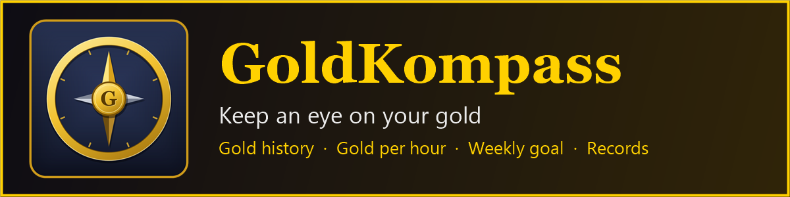
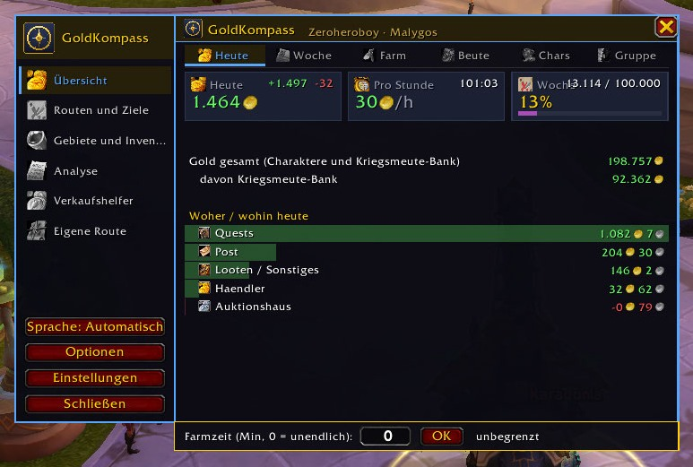
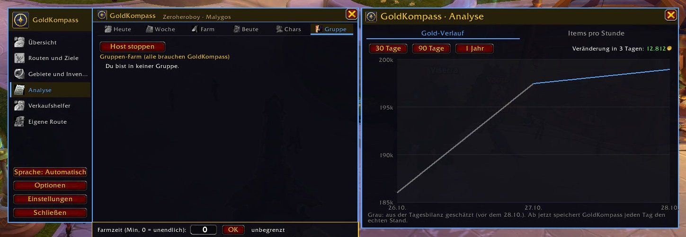
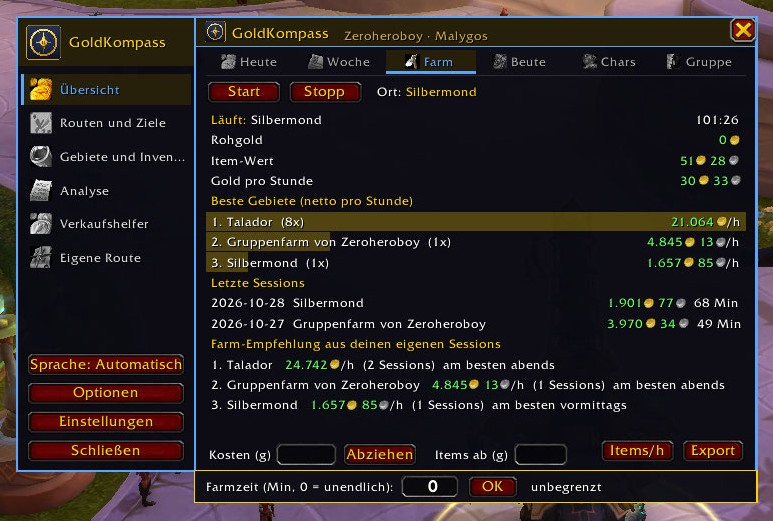
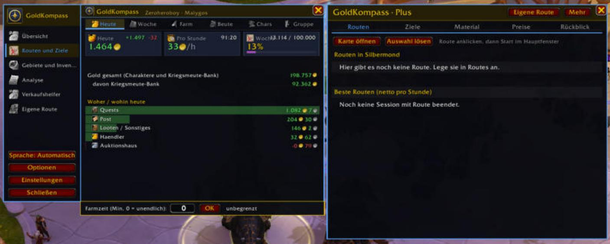
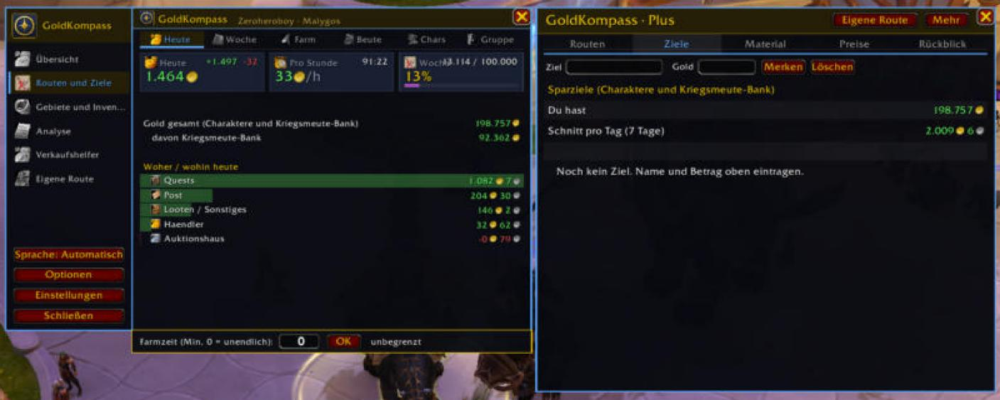
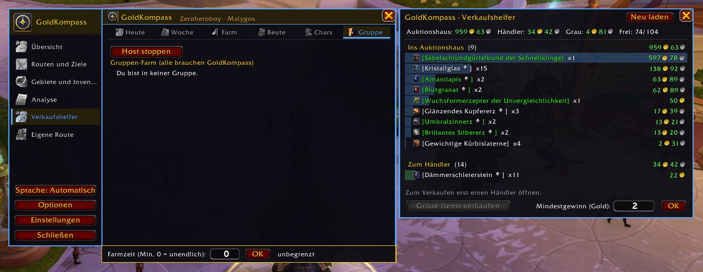
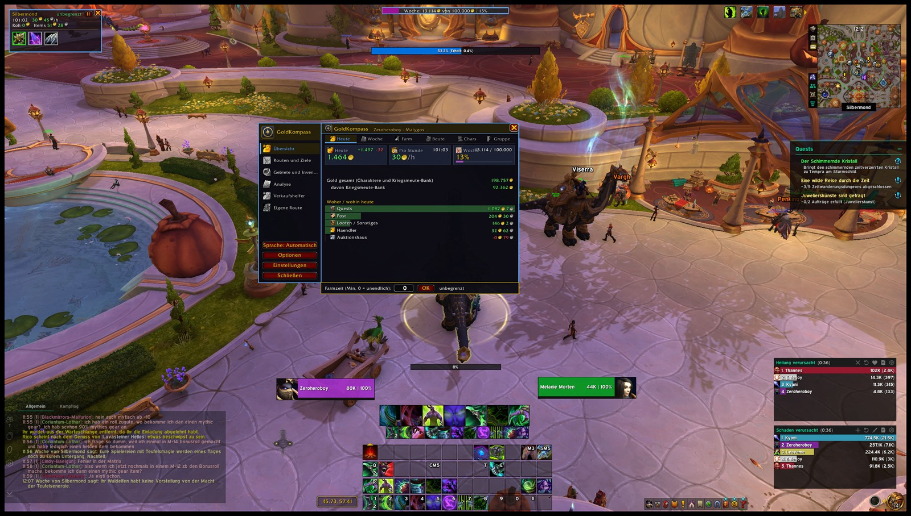

[English](#english) · [Deutsch](#deutsch) · [Screenshots](#screenshots)

World of Warcraft Retail addon (Midnight 12.x) · Author: Rottgar · CurseForge project 1768724

---

## English

**Keep an eye on your gold.** Where does it come from, where does it go, and how much do you earn per hour? GoldKompass records everything and shows it in one clear window. English and German.

### Features

**Overview**
- Gold today, gold per hour and weekly goal at a glance
- Income and expenses by source: loot, quests, vendor, auction house, auction sales, mail, trade
- Gold of all characters and the warband bank
- Gold history as a line chart over 30 days, 90 days or one year

**Farming**
- Farm sessions with start, stop and pause, also via key bindings
- Gold per hour including item value from Auctionator or TradeSkillMaster
- Small farm window showing your most valuable loot as quality-colored icons
- Items per hour by zone, best zones and routes compared
- Time limit, deduct costs, session is kept after /reload
- Routes support and your own routes shown on map and minimap

**Trading and selling**
- Sell helper: what belongs in the auction house and what goes to the vendor
- Price alarm and bargain alarm based on your own price history
- Value of your bags, bank and all characters, material tracker

**Together**
- Group farming with host button and group loot
- Guild weekly goal

**Records**
- Best farm hour, best day and best week with a golden pop-up for every new record
- Comparison with the previous week, pop-up when the weekly goal is reached

**Usability**
- One window with sidebar: the overview stays open, other pages open next to it
- Adjustable size, lockable position, optional hide in combat, window positions are remembered
- Addon compartment at the minimap, page under Esc > Options > AddOns, minimap button
- Display in Titan Panel, ElvUI, Bazooka and other bars (LibDataBroker)
- Backup: export and import settings or all data as text
- Five color themes, English or German

### Commands
- `/gk` open the window
- `/gk commands` show all commands
- `/gk start` and `/gk stop` farm session, `/gk pause` pause it
- `/gk goal 5000` set the weekly goal, `/gk goal off` remove it
- `/gk history` gold history, `/gk items` items per hour
- `/gk sell` sell helper, `/gk loot` group loot
- `/gk language en` or `/gk language de` choose the language
- `/gk backup` backup, `/gk selftest` self-test

German command names keep working in both languages.

### Optional
Auctionator or TradeSkillMaster (prices), Routes (farm routes), Titan Panel/ElvUI/Bazooka (bar display)

### FAQ
**No item value is shown.** Install Auctionator or TradeSkillMaster and open the auction house once so prices are scanned. Without them GoldKompass uses the vendor price.

**The window is gone.** Type `/gk`. If it is off screen, type `/gk scale 1` and drag it back by the sidebar.

**Where are my separate windows?** All pages open to the right of the overview. Turn off "One window" in the settings (`/gk settings`) for separate windows.

**Something is wrong.** Run `/gk selftest` and send the result together with the Lua error.

### Installation
Copy the `GoldKompass` folder to `World of Warcraft/_retail_/Interface/AddOns`, or install it with the CurseForge app.

---

## Deutsch

**Dein Gold im Blick.** Woher kommt es, wohin geht es, und wie viel verdienst du pro Stunde? GoldKompass zeichnet alles auf und zeigt es in einem übersichtlichen Fenster. Deutsch und Englisch.

### Funktionen

**Übersicht**
- Gold heute, Gold pro Stunde und Wochenziel auf einen Blick
- Einnahmen und Ausgaben nach Quelle: Looten, Quests, Händler, Auktionshaus, Auktionshaus-Verkäufe, Post, Handel
- Gold aller Charaktere und der Kriegsmeute-Bank
- Gold-Verlauf als Linie über 30 Tage, 90 Tage oder ein Jahr

**Farmen**
- Farm-Sessions mit Start, Stopp und Pause, auch per Tastenbelegung
- Gold pro Stunde mit Item-Wert aus Auctionator oder TradeSkillMaster
- Kleines Farm-Fenster mit den wertvollsten Funden als Symbole in Qualitätsfarbe
- Items pro Stunde je Gebiet, beste Gebiete und Routen im Vergleich
- Zeitlimit, Kosten abziehen, Sitzung bleibt nach /reload erhalten
- Routes-Anbindung und eigene Routen mit Anzeige auf Karte und Minimap

**Handeln und Verkaufen**
- Verkaufshelfer: was ins Auktionshaus gehört und was zum Händler
- Preisalarm und Schnäppchen-Alarm aus deinem eigenen Preisverlauf
- Wert deiner Taschen, Bank und aller Charaktere, Material-Tracker

**Gemeinsam**
- Gruppen-Farm mit Host-Knopf und Gruppen-Beute
- Gilden-Wochenziel

**Rekorde**
- Beste Farm-Stunde, bester Tag und beste Woche mit goldener Einblendung bei jedem neuen Rekord
- Vergleich mit der Vorwoche, Einblendung bei erreichtem Wochenziel

**Bedienung**
- Ein Fenster mit Seitenleiste: die Übersicht bleibt offen, andere Seiten öffnen sich daneben
- Größe einstellbar, Position sperrbar, im Kampf ausblendbar, Fensterpositionen werden gemerkt
- Addon-Menü an der Minimap, Seite unter Esc > Optionen > AddOns, Minimap-Button
- Anzeige in Titan Panel, ElvUI, Bazooka und anderen Leisten (LibDataBroker)
- Sicherung: Einstellungen oder alle Daten als Text exportieren und importieren
- Fünf Farbdesigns, Sprache Deutsch oder Englisch

### Befehle
- `/gk` Fenster öffnen
- `/gk befehle` alle Befehle anzeigen
- `/gk start` und `/gk stop` Farm-Session, `/gk pause` pausieren
- `/gk ziel 5000` Wochenziel setzen, `/gk ziel aus` entfernen
- `/gk verlauf` Gold-Verlauf, `/gk items` Items pro Stunde
- `/gk verkauf` Verkaufshelfer, `/gk beute` Gruppen-Beute
- `/gk sprache de` oder `/gk sprache en` Sprache wählen
- `/gk sicherung` Sicherung, `/gk selbsttest` Selbsttest

Die englischen Befehlsnamen funktionieren in beiden Sprachen.

### Optional
Auctionator oder TradeSkillMaster (Preise), Routes (Farm-Routen), Titan Panel/ElvUI/Bazooka (Leisten-Anzeige)

### Häufige Fragen
**Es wird kein Item-Wert angezeigt.** Auctionator oder TradeSkillMaster installieren und einmal das Auktionshaus öffnen, damit Preise gescannt werden. Ohne sie nimmt GoldKompass den Händlerpreis.

**Das Fenster ist weg.** `/gk` eingeben. Liegt es außerhalb des Bildschirms, `/gk groesse 1` eingeben und es an der Seitenleiste zurückziehen.

**Wo sind meine getrennten Fenster?** Alle Seiten öffnen sich rechts neben der Übersicht. Für getrennte Fenster in den Einstellungen (`/gk einstellungen`) „Ein Fenster“ ausschalten.

**Etwas funktioniert nicht.** `/gk selbsttest` ausführen und das Ergebnis zusammen mit der Lua-Fehlermeldung schicken.

### Installation
Den Ordner `GoldKompass` nach `World of Warcraft/_retail_/Interface/AddOns` kopieren oder über die CurseForge-App installieren.

---

## Screenshots

